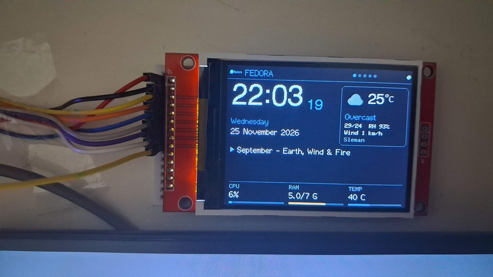
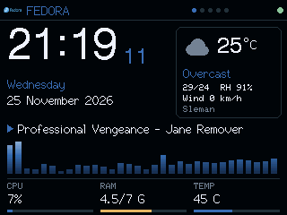
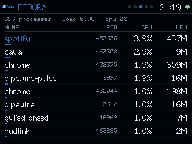
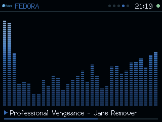
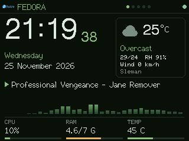
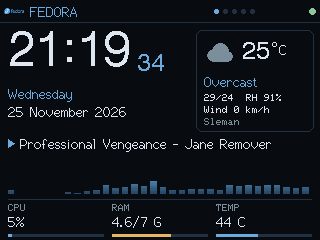
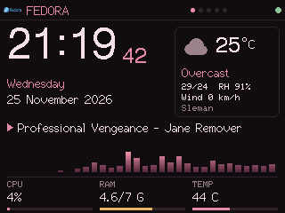
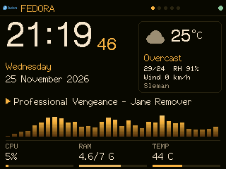
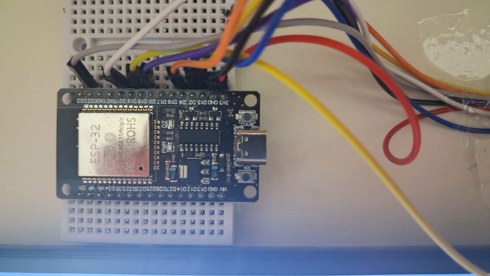

# hudlink-rs

**An ESP32 with a small screen, connected to your laptop, that shows a task manager, cava and the lyrics of the song you're playing.**
Rust daemon on the laptop + ESP32 firmware on the display.

> [!NOTE]
> This is a hobby and learning project. 


[](https://github.com/kali21rt/hudlink-rs/actions/workflows/ci.yml)

## Features

hudlink is for people who want an extra monitor without opening and closing apps just to see what's going on. You can check your CPU temperature, fan speed, the time and the lyrics without switching windows.

- **Task manager**: the 8 busiest processes with PID, CPU and memory (the feature I use the most)
- **Five pages**: home, system, process (apps and services running in the background), cava, lyrics
- **Synced lyrics** from [LRCLIB](https://lrclib.net) or local `.lrc` files, with the title of the song that's playing
- **Colors follow your system**: your distro's color, a preset theme, or your wallpaper (matugen)
- **Follows your laptop**: turns off when you lock your laptop, dims at night
- **Controlled from the terminal**: `hudlink set theme forest` or `hudlink next`

## Gallery

| Home | System | Process |
|---|---|---|
|  |  |  |

| Cava | Lyrics | Forest theme |
|---|---|---|
|  |  |  |

| Ocean | Rose | Amber |
|---|---|---|
|  |  |  |

All screenshots are taken from the display itself with `hudlink screenshot`.

## Hardware

| Part | Notes | USD | EUR | IDR |
|---|---|---|---|---|
| ESP32 DevKit V1 (30 pin) | any ESP32-WROOM board with a CH340 or CP2102 USB chip | 4 - 8 | 4 - 7 | Rp70.000 - 85.000 |
| 2.8" SPI TFT, 240x320, ILI9341 | the common red board, touch layer optional | 7 - 12 | 6 - 11 | Rp100.000 - 160.000 |
| Mini breadboard + jumper wires | female-female wires if you skip the breadboard | 2 - 4 | 2 - 4 | Rp15.000 - 30.000 |
| USB data cable | a charge-only cable won't work | | | |
| **Total** | | **~13 - 24** | **~12 - 22** | **~Rp185.000 - 275.000** |

Prices are rough, late 2026. AliExpress is usually the cheapest; local shops (Tokopedia, Shopee in Indonesia) are faster.

## Wiring



| Display pin | ESP32 pin | Note |
|---|---|---|
| VCC | 3V3 | |
| GND | GND | |
| CS | D15 | |
| RESET | D4 | |
| DC | D2 | |
| SDI (MOSI) | D23 | shared with T_DIN |
| SCK | D18 | shared with T_CLK |
| LED | D21 | backlight (PWM brightness) |
| SDO (MISO) | D19 | needed for screenshots |
| T_CLK, T_CS, T_DIN, T_DO | D18, D5, D23, D19 | only if your panel has touch |
| T_IRQ | not connected | |

Tips from my own build:

- D18, D23 and D19 each go to two display pins. Put each of them on one breadboard row so both wires meet there.
- Keep the jumpers short. If the picture glitches, lower `SPI_FREQUENCY` in `firmware/platformio.ini` from 40000000 to 27000000.
- If the upload hangs at `Connecting.....`, hold the BOOT button on the ESP32 until it starts writing.

## Installation

```bash
git clone https://github.com/kali21rt/hudlink-rs && cd hudlink-rs
bash scripts/install.sh      # packages, the daemon, the udev rule and autostart
pipx install platformio      # once, to build the firmware
bash scripts/flash.sh        # upload the firmware to the ESP32
hudlink setup                # city, language, clock and theme
```

That's it: from now on the display starts by itself when you plug it in.

- `install.sh` works with dnf (Fedora), apt (Debian, Ubuntu, Devuan), pacman (Arch), zypper (openSUSE) and xbps (Void).
- No systemd (OpenRC, runit)? The daemon starts at login and waits for the display.
- Something not working? Run `hudlink doctor`. It checks everything and tells you what to fix.

## Configuration

Every setting can be changed live from the terminal. It's applied right away and saved to `~/.config/hudlink/config`.

| Key | Values | What it does |
|---|---|---|
| `theme` | auto, matugen, distro, ocean, forest, rose, slate, mono, amber, kayon | color theme |
| `pages` | home, system, process, cava, lyrics | which pages to show, in order |
| `home_layout` | dashboard, clock, music | layout of the home page |
| `clock_style` | segment, digits, text | clock font |
| `clock_24h` | true, false | 24-hour or AM/PM |
| `language` | en, id | day and month names |
| `cava_bars` | 8 to 64 | number of bars |
| `cava_style` | bars, blocks, mirror | visualizer style |
| `cava_colors` | theme, cava | follow the theme, or your own cava config |
| `city` | any city name | weather location |
| `night_start`, `night_end` | e.g. 22:00, 06:00 | dim the screen at night |
| `lock_off` | true, false | turn off when the laptop is locked |
| `rotation` | 1, 3 | flip the screen 180 degrees |

```bash
hudlink set theme forest
hudlink set pages home, process, cava, lyrics
hudlink set cava_bars 48
hudlink next                  # next page (the BOOT button on the ESP32 works too)
hudlink rotate                # flip the screen
hudlink screenshot            # save what the display shows to ~/Pictures
hudlink status                # what the daemon is doing right now
```

## Themes and matugen

With `theme = auto` (the default), hudlink uses your distro's color, for example blue on Fedora. If your dotfiles use [matugen](https://github.com/InioX/matugen) (common with Niri and Hyprland setups), the display can follow your wallpaper:

1. Copy `system/matugen/hudlink-colors` to `~/.config/matugen/templates/` (`install.sh` does this if matugen is installed).
2. Add this to `~/.config/matugen/config.toml`:

```toml
[templates.hudlink]
input_path = '~/.config/matugen/templates/hudlink-colors'
output_path = '~/.config/hudlink/colors'
```

3. Change your wallpaper with matugen as usual. The display changes color within two seconds.

Without matugen nothing breaks: hudlink just uses your distro color or the preset you picked. To make the cava bars match the cava in your terminal, use `hudlink set cava_colors cava`.

## How it works

The ESP32's CPU is too weak to run all of this by itself, so we don't rely on it. Instead, the laptop runs a Rust daemon that collects everything (cava, CPU and memory stats, processes, weather, the current song and its lyrics) and sends small binary frames over the USB cable, about 1 to 2 KB per second. The ESP32 only draws what it receives, and only redraws the parts that changed. That's why cava runs smoothly without any lag: the real work happens on the laptop's CPU, and it uses very little of it.

```
cava, /proc, /sys, playerctl, Open-Meteo, LRCLIB
        |
   hudlink daemon (Rust, no external crates)
        |  small binary frames over USB, 1-2 KB/s
   ESP32 firmware (C++, TFT_eSPI)  ->  2.8" ILI9341 screen
```

Every frame looks like this: `A5 5A | type | length | payload | xor checksum`. The display can also send frames back, which is how `hudlink screenshot` reads the picture from the screen.

## Known limitations

- To be honest, I've only tested it on my own setup: ESP32 DevKit V1, ILI9341 2.8", Fedora 44 GNOME, ThinkPad L14 Gen 2. Other boards, screens and distros should work, but you may need to adjust the pins or settings in the code.
- No touchscreen support yet. Pages change with the BOOT button or the terminal.
- The screen only has ASCII fonts. Lyrics in Japanese, Korean, or Cyrillic (Russian, Ukrainian and other Slavic languages) show up as question marks (`?`). Accented Latin letters like `é` lose their accent.
- Fedora's cava package has no PipeWire input, so hudlink uses `pulse` by default.
- Turning off when locked needs a locker that tells logind (GNOME and KDE do; some Wayland lockers don't).

In the future I want to fix some of these, like touchscreen support and better fonts.

## Privacy

- Weather: your city (or coordinates) is sent to [Open-Meteo](https://open-meteo.com).
- Lyrics: the title, artist, album and length of the current song are sent to [LRCLIB](https://lrclib.net), unless a local `.lrc` file exists.
- Nothing else leaves your computer. Turn them off with `hudlink set city ""` and `hudlink set lyrics false`.

## History

At first I called it **Aksara HUD**. It was just for my own needs, so the name wasn't really thought through, and it was made especially for the OS I'm building, Aksara OS. Then v2 came, so every Linux distro could try it: it follows your distro's logo and colors, and it got lyrics, a task manager, terminal control and more.

I built it with the help of Claude (Anthropic), because I only started learning Rust recently, after Python and a little C++. I tried, failed, tried again, got it working but with bugs, fixed them, and got it working.

This is my first real step in learning Rust. Even though I still use AI, at least I can pour my ideas into something real. When I started learning Python I used AI too, but back then I typed most of the code myself instead of prompting, so I ended up with lots of bugs and mistakes. The biggest one was forcing the ESP32 to run everything by itself (cava, the task manager and so on) without a daemon on the laptop. hudlink is what I built after learning from that.

## Credits

- [TFT_eSPI](https://github.com/Bodmer/TFT_eSPI) by Bodmer, the display driver
- [cava](https://github.com/karlstav/cava) for the audio visualizer
- [playerctl](https://github.com/altdesktop/playerctl) for "now playing"
- [matugen](https://github.com/InioX/matugen) for wallpaper colors
- [Open-Meteo](https://open-meteo.com) for weather, [LRCLIB](https://lrclib.net) for lyrics
- [PlatformIO](https://platformio.org) for building the firmware
- Distro logos are read from the files your distro already installs. They are not part of this repository and belong to their projects.

## License

[GPL-3.0-or-later](LICENSE)
