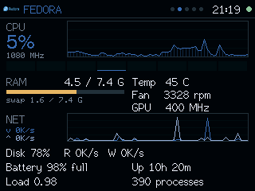
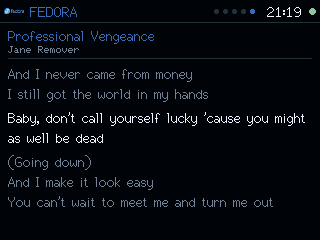

# hudlink

A tiny external status display for Linux. An ESP32 and a 2.8" SPI screen sit next to your laptop and show the time, weather, system load, running processes, a cava visualizer, the song that is playing and its synced lyrics. Colors follow your theme or your wallpaper (matugen), and the logo follows your distro.


[](../../actions/workflows/ci.yml)

## Features

- **Five pages**: home, system, process, cava, lyrics. Pick which ones you want and in what order.
- **Home layouts**: `dashboard` (clock, weather, now playing, stats), `clock` (big clock), `music` (track, progress, big visualizer).
- **System monitor**: 60-second CPU and network graphs, per-core load, CPU and GPU clocks, RAM and swap, temperature, fan, disk I/O, battery, load.
- **Task manager**: the 8 busiest processes with PID, CPU and memory.
- **Cava**: 8 to 64 bars, `bars` / `blocks` / `mirror` style, colors from the theme or from your own cava config.
- **Now playing and synced lyrics**: works with any MPRIS player (Spotify, Firefox, mpv, ...). Lyrics come from a local `.lrc` file or from [LRCLIB](https://lrclib.net).
- **Themes**: 7 presets, your distro's accent color, or matugen (the display changes color when you change your wallpaper).
- **Clock**: segment, digits or text style, 12/24 h, your own date format.
- **Follows the laptop**: starts when plugged in, turns off when you lock the session, dims at night.
- **Everything live from the terminal**: `hudlink set theme forest`, `hudlink next`, `hudlink screenshot`.

## Gallery

| Home | System | Process |
|---|---|---|
|  |  |  |

| Cava | Lyrics | Themes |
|---|---|---|
|  |  |  |

The screenshots are taken from the display itself with `hudlink screenshot`.

## Hardware

| Part | Notes | Approx. price |
|---|---|---|
| ESP32 DevKit V1 (30 pin) | any ESP32-WROOM board with a CH340 or CP2102 USB chip | ~5 USD |
| 2.8" SPI TFT, 240x320, ILI9341 | the common red board; the touch layer is optional | ~7 USD |
| Mini breadboard + jumper wires | female-female if you skip the breadboard | ~2 USD |
| USB data cable | a charge-only cable will not work | |

### Wiring

| Display pin | ESP32 | |
|---|---|---|
| VCC | 3V3 | |
| GND | GND | |
| CS | D15 | |
| RESET | D4 | |
| DC | D2 | |
| SDI (MOSI) | D23 | shared with T_DIN |
| SCK | D18 | shared with T_CLK |
| LED | D21 | backlight, PWM |
| SDO (MISO) | D19 | needed for screenshots |
| T_CLK / T_CS / T_DIN / T_DO | D18 / D5 / D23 / D19 | only if your panel has touch |

## Install

```bash
git clone https://github.com/<you>/hudlink && cd hudlink
bash scripts/install.sh     # packages, daemon, udev rule, autostart
pipx install platformio     # once, to build the firmware
bash scripts/flash.sh       # upload the firmware
hudlink setup               # city, language, clock, theme
hudlink doctor              # checks everything and tells you what to fix
```

`install.sh` supports dnf, apt, pacman, zypper and xbps. With a systemd user session the daemon starts when the display is plugged in; without systemd (OpenRC, runit) it starts at login and waits for the display.

## Usage

```bash
hudlink next | prev | page lyrics      # change page (the BOOT button on the ESP32 works too)
hudlink set theme forest               # any config key, applied live and saved
hudlink set pages home, cava, lyrics
hudlink set cava_bars 48
hudlink rotate                         # flip 180 degrees
hudlink screenshot                     # saves to ~/Pictures
hudlink status | doctor | get | themes | edit
```

The config lives in `~/.config/hudlink/config` and every key is documented inside it.

### Following matugen

Copy `system/matugen/hudlink-colors` to `~/.config/matugen/templates/` and add this to `~/.config/matugen/config.toml`:

```toml
[templates.hudlink]
input_path = '~/.config/matugen/templates/hudlink-colors'
output_path = '~/.config/hudlink/colors'
```

With `theme = auto` (the default) hudlink uses these colors whenever the file exists and updates the display within two seconds of a wallpaper change.

## How it works

The ESP32 does not run cava or read anything from the laptop. The laptop does the work and the ESP32 only draws:

```
cava, /proc, /sys, playerctl, Open-Meteo, LRCLIB
        |
   hudlink daemon (Rust, no external crates)
        |  small binary frames over USB serial, 1-2 KB/s
   ESP32 firmware (C++, TFT_eSPI) -> 2.8" ILI9341
```

Each frame is `A5 5A | type | length | payload | xor checksum`. The display redraws only what changed, so cava runs at 30 fps without a framebuffer (the ESP32 has no room for a full 320x240 buffer). The display can also send frames back: that is how screenshots work.

## Known limitations

- Tested on one setup only: ESP32 DevKit V1 + ILI9341 2.8", Fedora 44 GNOME, ThinkPad L14 Gen 2. Other boards, panels and distros should work but are untested. Reports are welcome.
- The display fonts are ASCII only. Accented Latin letters lose their accent; Japanese, Korean or Arabic lyrics show as `?`.
- Fedora's cava package has no PipeWire input, so the default is `cava_input = pulse` (works through pipewire-pulse).
- Turning off on lock needs a locker that sets logind's `LockedHint` (GNOME and KDE do; some Wayland lockers don't).
- The touch layer is supported in the firmware but off by default (`USE_TOUCH`), because my panel has none.

## Privacy

- Weather: your city or coordinates are sent to [Open-Meteo](https://open-meteo.com).
- Lyrics: the title, artist, album and length of the current song are sent to [LRCLIB](https://lrclib.net), unless a local `.lrc` file exists.
- Nothing else leaves your computer. Turn both off with `city =` and `lyrics = false`.

## How this was made

hudlink started as **Aksara HUD**, a side project for my own laptop and for [Aksara OS](#), the Linux distro I am building. I wanted a small cyberdeck-style screen with cava, a task manager and lyrics, so I designed the features and the look, wired the hardware, tested every version on the real display and fixed what broke.

Most of the code was written with the help of Claude (Anthropic) as a pair programmer. I am still learning Rust, and the daemon is deliberately written without external crates so it is easy to read module by module.

## Credits

- [TFT_eSPI](https://github.com/Bodmer/TFT_eSPI) by Bodmer, the display driver
- [cava](https://github.com/karlstav/cava), [playerctl](https://github.com/altdesktop/playerctl), [matugen](https://github.com/InioX/matugen)
- [Open-Meteo](https://open-meteo.com) for weather, [LRCLIB](https://lrclib.net) for lyrics
- Distro logos are read from the files your distro already installs; they are not part of this repository and belong to their projects.

## License

GPL-3.0-or-later
